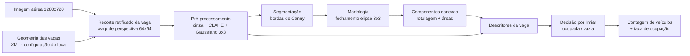
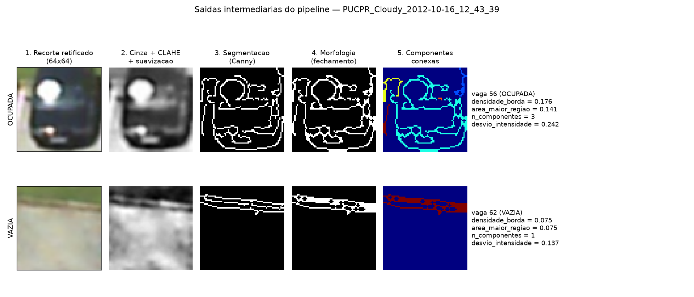
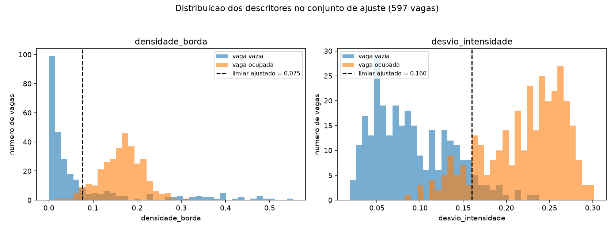
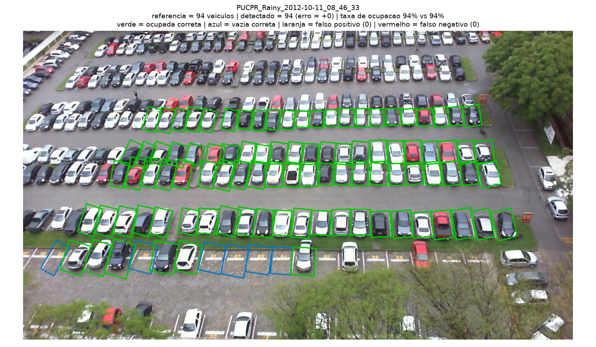
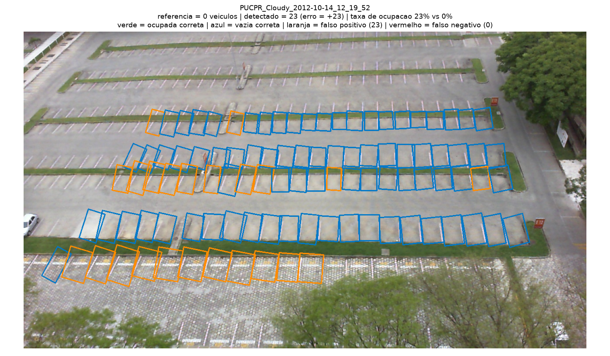
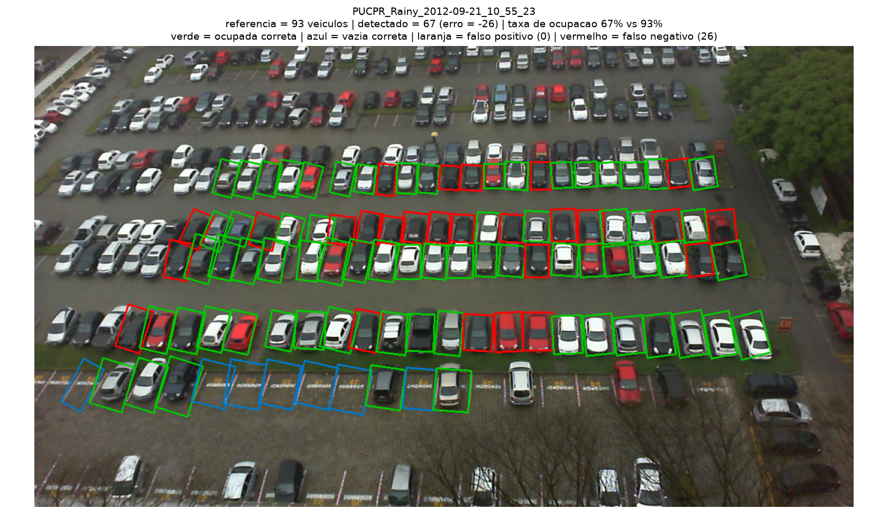
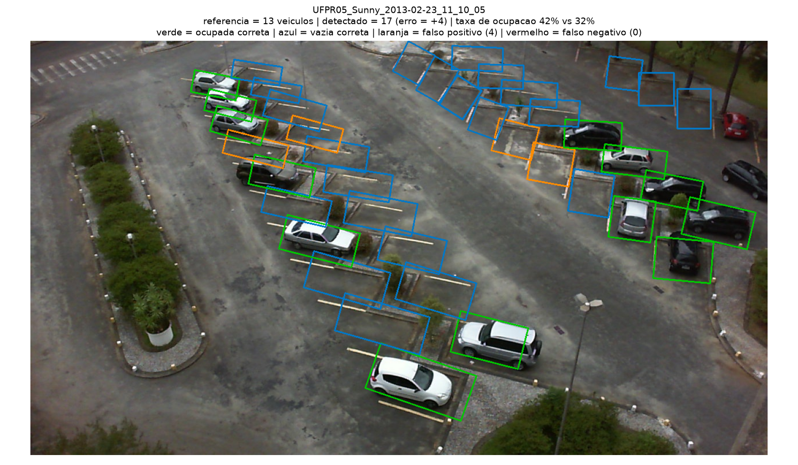
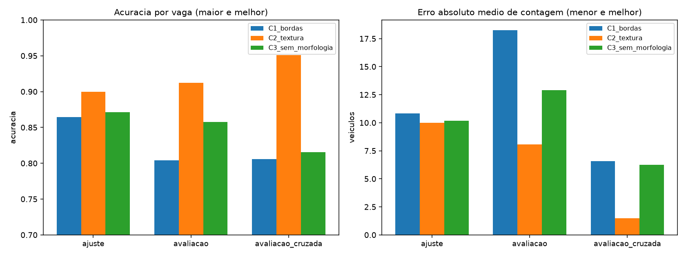

# Relatório Parcial — M2
## Contagem de Veículos em Estacionamentos a partir de Imagens Aéreas

**Integrantes:** Toni Tison Zamparetti, Gustavo Oliveira
**Repositório:** https://github.com/Tonitzpp/pdi-contagem-veiculos
**Proposta da M1:** [`docs/proposta.md`](proposta.md)

---

## 1. Problema e objetivos

Estacionamentos de grande porte precisam saber, com frequência, quantos
veículos estão presentes. Contagem manual ou sensores por vaga são caros e
difíceis de escalar. Investigamos até que ponto técnicas clássicas de PDI
conseguem, a partir de **uma única imagem aérea**, decidir vaga a vaga se ela
está ocupada e produzir daí a **contagem de veículos**.

**Objetivo geral:** implementar e avaliar um pipeline de PDI que receba uma
imagem aérea de estacionamento e a geometria das vagas monitoradas, e produza
o número de veículos estacionados, com erro medido contra uma referência
anotada. A **taxa de ocupação** é uma saída secundária, derivada da contagem
(ver resposta 2 na seção 2).

### Critérios de sucesso e situação atual

Medidos no conjunto de avaliação (1 200 vagas, nunca usadas no ajuste) e no de
avaliação cruzada (407 vagas, de dois estacionamentos nunca vistos):

| Critério | Meta para a M3 | Avaliação | Avaliação cruzada |
|---|---|---:|---:|
| Acurácia por vaga | ≥ 95 % | 91,3 % | **95,1 %** |
| MAE de contagem por imagem | ≤ 5 veículos | 8,08 | **1,50** |
| RMSE de contagem por imagem | ≤ 8 veículos | 10,91 | **1,91** |

### Etapas pendentes para a M3

| # | Pendência |
|---|---|
| 1 | Substituir o limiar único por um classificador sobre o vetor de descritores |
| 2 | Descritores de textura que separem piso texturizado de veículo (limitação 7.1) |
| 3 | Detecção automática da grade de vagas, hoje vinda da anotação (limitação 7.4) |

---

## 2. Resposta ao feedback da M1

Devolutiva recebida sobre o commit `ca1b8c6`. Cada direcionamento e a ação
tomada:

| # | Direcionamento | Ação tomada |
|---|---|---|
| 1 | Obter o CARPK e registrar licença, estrutura e anotações | **Adotada outra solução.** O CARPK só é distribuído mediante preenchimento de formulário de solicitação, o que impede documentar um procedimento de obtenção reproduzível em um repositório público. Trocamos pelo **PKLot (VRI/UFPR)**: licença **CC BY 4.0** explícita, download direto por URL, e anotação **por vaga**. Licença, estrutura e anotações estão registradas em [`images/input/pklot/FONTE.md`](../images/input/pklot/FONTE.md) e na seção 3. O objetivo do direcionamento — sair dos dados sintéticos para um dataset real, licenciado e documentado — foi cumprido. |
| 2 | Abandonar a taxa de ocupação como requisito principal caso não haja anotação de vagas | **Adotada.** A contagem de veículos passou a ser a **saída principal** do sistema e o alvo das métricas. Como o PKLot anota cada vaga individualmente, a taxa de ocupação continua disponível, mas como saída **secundária, derivada da contagem** (`detectados ÷ vagas monitoradas`), e não como segunda tarefa com requisitos próprios. |
| 3 | Dividir imagens por local/cena, evitando treino e teste quase idênticos | **Adotada.** Além de separar ajuste e avaliação por **data** (nunca a mesma data dos dois lados), criamos o conjunto **`avaliacao_cruzada`**: 12 imagens de **dois estacionamentos que não aparecem no ajuste** (UFPR04 e UFPR05), com outra câmera, outro ângulo e outra escala. É esse conjunto que mede generalização de verdade (seção 4). |
| 4 | Medir MAE, RMSE e erro relativo por imagem, além de precisão/recall | **Adotada.** `results/m2_resumo.csv` traz MAE, RMSE, viés, erro relativo médio, erro da taxa em pp, precisão, revocação, FP e FN por configuração e conjunto; `results/m2_metricas_por_imagem.csv` traz o erro imagem a imagem. Observação sobre o erro relativo na seção 5.4. |
| 5 | Manter a baseline clássica e só depois compará-la com detector aprendido | **Adotada.** A M2 é inteiramente clássica (CLAHE, Canny, morfologia, componentes conexas, descritores, limiar). Nenhum modelo aprendido foi usado; o classificador entra só na M3, e será comparado contra esta baseline. |
| — | **Prioridade imediata:** repetir o pipeline em dados reais e documentar quais hipóteses do cenário sintético deixam de valer | **Atendida** na seção 2.1. |

### 2.1 Hipóteses do cenário sintético que deixaram de valer

Ao rodar o pipeline da M1 sobre imagens reais, quatro hipóteses embutidas na
imagem sintética caíram:

| Hipótese do cenário sintético | O que acontece no real | Consequência |
|---|---|---|
| Veículo = retângulo sólido de cor uniforme | O veículo tem vidros, brilho especular, sombra própria e reflexos; sua superfície não é uniforme | A detecção por "mancha de cor" deixa de funcionar; passamos a usar a **variação interna** da vaga como evidência |
| Veículos têm cores saturadas | A maioria é branca, prata, cinza ou preta — **acromática** | O critério de saturação (HSV) da M1 foi abandonado: ele não enxerga justamente os carros mais comuns. Todos os descritores da M2 são acromáticos |
| Fundo = asfalto homogêneo | O fundo tem grama, paralelepípedo, cascalho, guias de concreto, remendos e manchas de óleo | Surgiu o modo de falha dominante da M2: **piso texturizado confundido com veículo** (seção 7.1) |
| Marcações de vaga = linhas retas e claras | Marcações desgastadas, parcialmente ocultas sob os veículos, e vagas em ângulos variados por perspectiva | Deixamos de segmentar a imagem inteira e passamos a **recortar e retificar cada vaga** antes de processar — o que elimina de uma vez o problema da M1 (morfologia fundindo veículo e marcação) e o de veículos colados |

A hipótese que **continuou valendo** é a de que a presença do veículo altera
mensuravelmente a estrutura interna da vaga — é sobre ela que o pipeline da M2
se apoia.

### 2.2 Demais mudanças desde a M1

| O que mudou | M1 | M2 |
|---|---|---|
| Imagens | 1 imagem sintética | **30 imagens reais, 2 204 vagas anotadas**, 3 climas, 3 estacionamentos |
| Unidade de análise | imagem inteira, detecção de blobs | vaga a vaga, com recorte retificado |
| Protocolo | inspeção visual | ajuste / avaliação / avaliação cruzada, disjuntos |
| Código | 1 script monolítico | 4 módulos em `src/` |

O experimento da M1 (`src/experimento_contagem.py`) foi mantido sem alterações
como registro da etapa anterior.

---

## 3. Dados

**PKLot — A Robust Dataset for Parking Lot Classification** (VRI/UFPR),
licença **CC BY 4.0**, download em
`https://www.inf.ufpr.br/vri/databases/PKLot.tar.gz` (≈ 4,9 GB). Imagens JPEG
RGB de **1280 × 720** de câmera fixa instalada em edifício, com vista aérea do
estacionamento. Cada imagem vem com um XML que descreve, para cada vaga
monitorada, um retângulo rotacionado e o rótulo `occupied` (0/1).

Como a licença permite redistribuição com atribuição, versionamos apenas as
**30 imagens usadas nos experimentos** (≈ 11 MB), com atribuição em
[`images/input/pklot/FONTE.md`](../images/input/pklot/FONTE.md). O dataset
completo **não** é versionado.

| Local | Câmera | Vagas monitoradas / imagem | Característica |
|---|---|---:|---|
| PUCPR | 10.º andar | 100 | vista quase vertical, veículos pequenos e densos |
| UFPR04 | 4.º andar | 28 | vista bem mais oblíqua, oclusão por árvores e postes |
| UFPR05 | 5.º andar | 40 | vista oblíqua, canteiros de concreto entre as vagas |

As vagas monitoradas são um subconjunto das visíveis: veículos fora delas
aparecem na imagem mas não entram na contagem nem na referência (limitação 7.3).

### 3.1 Referência de avaliação

A referência é o campo `occupied` da anotação original do PKLot, produzida
pelos autores do dataset — não por nós. É independente do grupo, mas não
controlamos o critério usado por eles em casos ambíguos (veículo entre duas
vagas, veículo parcialmente oculto). Em inspeção visual das 30 imagens não
encontramos erro evidente, mas a conferência não foi exaustiva vaga a vaga.

---

## 4. Protocolo experimental

| Conjunto | Local | Imagens | Vagas | Papel |
|---|---|---:|---:|---|
| `ajuste` | PUCPR | 6 | 597 | escolher parâmetros e o limiar de decisão |
| `avaliacao` | PUCPR | 12 | 1 200 | **mesma cena**, datas disjuntas das de ajuste |
| `avaliacao_cruzada` | UFPR04 + UFPR05 | 12 | 407 | **estacionamentos nunca vistos** no ajuste |

Dois níveis de separação, atendendo ao direcionamento 3:

- **Por data** — imagens da mesma data são quase idênticas (mesma câmera, mesma
  iluminação, muitos carros nos mesmos lugares); nenhuma data aparece ao mesmo
  tempo em ajuste e avaliação. Para cada clima (Sunny, Cloudy, Rainy)
  escolhemos datas distintas e, dentro de cada data, a imagem mediana do dia.
- **Por local/cena** — o conjunto cruzado troca câmera, ângulo, escala e
  estacionamento inteiros. É o número que mede generalização.

A amostra cobre taxas de ocupação de **0 % a 100 %** de propósito: imagens
vazias são as únicas em que falsos positivos aparecem sem nada para
mascará-los. Inclui também uma imagem **noturna sob chuva**
(`UFPR04_Rainy_2012-12-19_20_10_16`).

**Procedimento.** (1) Parâmetros de geometria e pré-processamento fixados por
inspeção, usando só o conjunto de ajuste. (2) Limiar de decisão escolhido
varrendo 200 quantis do descritor **no conjunto de ajuste**, tomando a maior
acurácia. (3) Esse limiar aplicado **sem reajuste** aos dois conjuntos de
avaliação. (4) Todas as configurações usam as mesmas imagens, os mesmos
recortes e o mesmo procedimento de escolha de limiar — só muda o item sob
teste. Não há treinamento nesta etapa.

---

## 5. Pipeline implementado

| Etapa | Finalidade | Entrada → Saída | Função |
|---|---|---|---|
| Recorte retificado | Tornar todas as vagas comparáveis apesar de posição, ângulo e perspectiva | imagem + retângulo → patch 64 × 64 | `pklot.recortar_vaga` |
| Pré-processamento | Reduzir ruído e equalizar o contraste local entre vagas iluminadas e sombreadas | patch BGR → patch cinza realçado | `pipeline.preprocessar` |
| Segmentação | Separar estrutura (silhueta do veículo) de fundo (asfalto homogêneo) | patch cinza → máscara binária | `pipeline.segmentar` |
| Morfologia | Unir bordas fragmentadas do mesmo veículo | máscara bruta → máscara fechada | `pipeline.segmentar` |
| Componentes conexas | Medir regiões em vez de contar pixels soltos | máscara → rótulos + áreas | `pipeline.analisar_componentes` |
| Descrição | Resumir a vaga em atributos numéricos | máscara + patch → 4 descritores | `pipeline.descrever` |
| Decisão e contagem | Produzir a saída do sistema | descritores → contagem, taxa | `pipeline.decidir`, `pipeline.contar` |

### 5.1 Descritores

Calculados para cada vaga e gravados em `results/m2_descritores.csv`:

| Descritor | Definição | Unidade |
|---|---|---|
| `densidade_borda` | pixels marcados na máscara ÷ pixels do patch | fração, 0–1 |
| `area_maior_regiao` | área da maior componente conexa ÷ área do patch | fração, 0–1 |
| `n_componentes` | componentes conexas com área ≥ 1 % do patch | contagem |
| `desvio_intensidade` | desvio padrão da intensidade do patch realçado ÷ 255 | fração, 0–1 |

### 5.2 Parâmetros e justificativa

| Parâmetro | Valor | Por quê |
|---|---|---|
| Lado do patch | 64 px | Preserva a silhueta (a vaga tem ~50 × 45 px no PUCPR) sem interpolar demais |
| Escala do retângulo | 0,85 | O retângulo anotado inclui asfalto e encosta nos vizinhos; encolher 15 % concentra o recorte no interior da vaga |
| CLAHE | `clipLimit=2.0`, `tile=(4,4)` | Vagas da mesma imagem estão sob luz muito diferente; o realce **local** torna um limiar único comparável entre elas. Blocos 4 × 4 em 64 px dão regiões de 16 px, da ordem das partes do veículo |
| Suavização | Gaussiano 3 × 3 | Remove ruído de compressão JPEG, que vira borda espúria no Canny |
| Canny | 50 / 150 | Razão 1:3 recomendada por Canny; verificado no ajuste contra (30, 90) e (80, 200) |
| Elemento estruturante | elipse 3 × 3, 1 iteração | Pequeno de propósito: une bordas do veículo sem fundir a vaga em uma mancha |
| Área mínima de componente | 1 % do patch | Descarta fragmentos de marcação e ruído |
| Limiar de decisão | ajustado, não fixado a priori | Seção 4 |

### 5.3 Saídas intermediárias

**Figura 1 — Etapas do pipeline para uma vaga ocupada (acima) e uma vazia
(abaixo), ambas medianas na sua classe, em `PUCPR_Cloudy_2012-10-16_12_43_39`.**
Da esquerda para a direita: recorte retificado, pré-processamento, segmentação
por Canny, máscara após o fechamento e componentes conexas coloridas. A vaga
ocupada produz uma malha densa de bordas internas (`densidade_borda = 0,176`);
a vazia produz apenas a borda do canteiro de grama que corta o recorte
(`0,075`). Já se vê aqui o que a seção 6.2 vai quantificar: **o fechamento
engrossa e conecta justamente essa borda de canteiro**, que é fundo.

### 5.4 Sobre o erro relativo

O erro relativo por imagem (`|detectado − referência| ÷ referência`) é
**indefinido para imagens sem nenhum veículo** e explode em imagens quase
vazias — uma imagem com 3 veículos de referência e 13 detectados dá 333 %.
Por isso reportamos a média apenas sobre as imagens com referência > 0 e
indicamos quantas são (`n_imagens_erro_relativo`), e usamos MAE e RMSE como
indicadores principais. No conjunto cruzado, onde a ocupação é mais alta, o
erro relativo médio é **6,9 %**; no de avaliação, que inclui duas imagens
quase vazias, sobe a 50,5 % sem que o erro absoluto seja maior.

---

## 6. Experimentos

Todos os números vêm de uma execução de `python src/experimento_m2.py`, que
grava `results/m2_resumo.csv`, `results/m2_metricas_por_imagem.csv`,
`results/m2_descritores.csv` e as figuras.

### 6.1 Experimento 1 — qual descritor separa melhor as classes?

**Pergunta:** o descritor obtido da segmentação (`densidade_borda`) separa vaga
ocupada de vazia melhor que um descritor fotométrico (`desvio_intensidade`)?
**Muda:** só o descritor da decisão. **Constante:** imagens, recortes,
pré-processamento, segmentação, morfologia e o procedimento de escolha do limiar.

| Conjunto | Config | Acurácia | Precisão | Revocação | FP | FN | MAE | RMSE | Erro da taxa |
|---|---|---:|---:|---:|---:|---:|---:|---:|---:|
| avaliação | C1 `densidade_borda` | 0,804 | 0,732 | 0,987 | 227 | 8 | 18,25 | 23,99 | 18,25 pp |
| avaliação | **C2 `desvio_intensidade`** | **0,913** | 0,876 | 0,970 | 86 | 19 | **8,08** | **10,91** | 8,08 pp |
| cruzada | C1 `densidade_borda` | 0,806 | 0,800 | 1,000 | 79 | 0 | 6,58 | 10,86 | 20,39 pp |
| cruzada | **C2 `desvio_intensidade`** | **0,951** | 0,957 | 0,981 | 14 | 6 | **1,50** | **1,91** | 4,47 pp |

**Figura 2 — Distribuição dos dois descritores no conjunto de ajuste (597
vagas), com o limiar escolhido.** À esquerda, `densidade_borda`: as vagas
vazias concentram-se perto de zero, mas há uma **cauda longa de vagas vazias
com densidade alta (0,3 a 0,55)** — vagas sobre grama, paralelepípedo ou
cortadas por canteiro, que produzem tantas bordas quanto um veículo. À direita,
`desvio_intensidade`: as classes também se sobrepõem, mas em uma faixa estreita
em torno de 0,13–0,17, sem cauda contaminada.

**Interpretação.** O descritor fotométrico vence com folga nos dois conjuntos:
+10,9 pontos de acurácia na avaliação e +14,5 na cruzada; o MAE cai de 18,3
para 8,1 e de 6,6 para 1,5. O motivo está na Figura 2: a densidade de borda
**não distingue estrutura de veículo de estrutura de piso**. Como o limiar
precisa ser baixo o bastante para capturar veículos escuros, ele deixa passar
todo piso texturizado — daí 227 falsos positivos contra 8 falsos negativos na
avaliação. C1 quase não perde veículos (revocação 0,987), mas enxerga veículos
onde não há.

Isso não torna a segmentação inútil: é dela que sai `area_maior_regiao`, usada
no teste da seção 6.4, e são as suas saídas intermediárias que tornam a decisão
inspecionável (Figura 1). O que o experimento mostra é que a *densidade* de
bordas, sozinha, é um descritor fraco para esse fundo.

### 6.2 Experimento 2 — o fechamento morfológico ajuda?

**Pergunta:** o fechamento consolida a silhueta do veículo ou só engrossa a
resposta do piso? **Muda:** só a presença do `cv2.MORPH_CLOSE`. **Constante:**
todo o resto, inclusive o descritor e o ajuste do limiar.

| Conjunto | Config | Acurácia | FP | FN | MAE | RMSE |
|---|---|---:|---:|---:|---:|---:|
| avaliação | C1 **com** fechamento | 0,804 | 227 | 8 | 18,25 | 23,99 |
| avaliação | C3 **sem** fechamento | **0,858** | 163 | 8 | **12,92** | **17,15** |
| cruzada | C1 **com** fechamento | 0,806 | 79 | 0 | 6,58 | 10,86 |
| cruzada | C3 **sem** fechamento | **0,816** | 75 | 0 | **6,25** | **10,23** |

**Interpretação — a mudança que piora.** O fechamento **degrada** o resultado:
5,3 pontos de acurácia e 64 falsos positivos a mais na avaliação, sem recuperar
um único falso negativo (ambos ficam em 8). A explicação está na Figura 1: as
bordas de um veículo já saem razoavelmente conectadas pelo Canny, então o
fechamento acrescenta pouco a elas; já as bordas finas e paralelas do
paralelepípedo e das guias de canteiro ficam **a poucos pixels umas das
outras**, e são exatamente essas que o elemento estruturante 3 × 3 une,
transformando textura de fundo em região sólida. A operação está sendo aplicada
no lugar errado: o fundo se beneficia dela mais que o objeto. Conclusão para a
M3: morfologia só depois de uma segmentação que já separe veículo de piso.

### 6.3 Casos de sucesso e de falha

**Figura 3 — Melhor caso da avaliação (C2): `PUCPR_Rainy_2012-10-11_08_46_33`,
94 de referência, 94 detectados, erro 0, acurácia 100 %.** Estacionamento quase
lotado sob chuva: os veículos ocupam o recorte inteiro e as poucas vagas vazias
são asfalto molhado homogêneo — o cenário mais favorável possível.

**Figura 4 — Pior caso da avaliação (C2): `PUCPR_Cloudy_2012-10-14_12_19_52`,
0 de referência, 23 detectados, erro +23.** Todos os erros são falsos positivos
(laranja), **concentrados em dois lugares**: a fileira inferior, sobre **piso de
paralelepípedo**, e as vagas cortadas pela **faixa de grama** entre fileiras. O
`desvio_intensidade` dessas vagas vazias é alto porque o próprio piso é
texturizado. É o modo de falha dominante, e é previsível a partir da Figura 2.

**Figura 5 — Modo de falha oposto, no ajuste:
`PUCPR_Rainy_2012-09-21_10_55_23`, 93 de referência, 67 detectados, erro −26.**
Os falsos negativos (vermelho) caem quase todos sobre **veículos escuros
(pretos, cinza-escuros, vinho) sob luz difusa de dia chuvoso**: o veículo
preenche a vaga, mas sua superfície é quase uniforme e sem brilho, então a
variação de intensidade fica abaixo do limiar. É a limitação da M1 (veículos de
baixa saturação) reaparecendo em outra forma — e confirma que ela é propriedade
do problema, não do critério que usávamos antes.

**Figura 6 — Pior caso da avaliação cruzada (C2):
`UFPR05_Sunny_2013-02-23_11_10_05`, 13 de referência, 17 detectados, erro +4,
acurácia 90 %.** O limiar ajustado no PUCPR foi transferido sem reajuste para o
UFPR05 — outra câmera, outro ângulo, outra escala. Os quatro falsos positivos
caem em vagas vazias atravessadas por **canteiros de concreto com vegetação e
cascalho**, o mesmo mecanismo da Figura 4. Note que, apesar de ser o pior caso
do conjunto, o erro é de 4 veículos.

### 6.4 Comparação geral e teste exploratório

**Figura 7 — Acurácia por vaga e MAE de contagem das três configurações, nos
três conjuntos.** O eixo de acurácia está cortado em 0,70 para que as
diferenças fiquem legíveis. C2 fica à frente nos três conjuntos e C3 à frente de
C1 em todos eles, o que indica que as conclusões dos dois experimentos não são
acidente de uma partição específica.

Testamos também combinar os dois tipos de descritor (`C4_combinado`, em
`results/m2_resumo.csv`): "ocupada se `desvio_intensidade` ≥ T₁ **e**
`area_maior_regiao` ≥ T₂", com os limiares buscados em grade no ajuste.

| Configuração | Acurácia (avaliação) | MAE | Acurácia (cruzada) | MAE |
|---|---:|---:|---:|---:|
| C2 (limiar único) | 0,913 | 8,08 | 0,951 | 1,50 |
| C4 (dois descritores, regra E) | **0,915** | **7,83** | **0,953** | **1,42** |

O ganho é de 0,2 ponto percentual. Uma regra booleana com dois limiares não
aproveita o descritor da segmentação; é isso que motiva trocar a regra manual
por um classificador treinado sobre o vetor completo de descritores na M3.

---

## 7. Limitações e riscos

1. **Falsos positivos sobre piso texturizado (dominante).** Vagas vazias sobre
   paralelepípedo, grama, cascalho ou asfalto remendado produzem variação de
   intensidade comparável à de um veículo. Responde pela maioria dos falsos
   positivos e pelo pior caso inteiro (Figuras 4 e 6). **Risco:** em um
   estacionamento de piso heterogêneo, o erro pode ficar bem acima do medido.
2. **Falsos negativos em veículos escuros sob luz difusa** (Figura 5) —
   limitação herdada da M1.
3. **Escopo da contagem.** Só são contados veículos **nas vagas monitoradas**;
   veículos fora delas ou em circulação são ignorados. É coerente com o
   objetivo, mas "veículos na imagem" e "veículos contados" não são a mesma
   coisa.
4. **Dependência da geometria anotada.** O pipeline recebe a posição das vagas
   pronta. É defensável na aplicação (câmera fixa, vagas marcadas uma vez), mas
   é uma etapa do problema ainda não resolvida automaticamente — o item de
   maior risco da M3.
5. **Tamanho da amostra.** 2 204 vagas bastam para comparar configurações, mas
   o conjunto de ajuste vem de um único estacionamento, e as médias por clima
   não são balanceadas.
6. **Referência não auditada vaga a vaga** (seção 3.1).

---

## 8. Plano da M3

| # | Tarefa | Responsável | Evidência esperada |
|---|---|---|---|
| 1 | Substituir o limiar único por um classificador (árvore de decisão ou SVM linear) sobre os 4 descritores, treinado só no ajuste | Gustavo | `src/classificador.py`, `results/m3_resumo.csv`, comparação direta com C2 |
| 2 | Acrescentar descritores que ataquem a limitação 7.1 (LBP, textura direcional, gradiente dominante) | Toni | nova coluna em `results/m3_descritores.csv` + histograma de separabilidade |
| 3 | Ampliar a amostra para ≥ 60 imagens, com mais imagens de ocupação baixa | Toni | `images/input/pklot/` atualizado e seção de dados revisada |
| 4 | Ajustar no PUCPR e avaliar separadamente em UFPR04 e UFPR05, reportando MAE, RMSE e erro relativo por local | Gustavo | tabela de métricas por estacionamento |
| 5 | Protótipo de detecção automática da grade de vagas (Hough sobre as marcações + agrupamento), avaliado por IoU contra os retângulos anotados | Toni | figura de sobreposição + IoU médio; se inviável, relatório do motivo |
| 6 | Relatório final e consolidação contra as metas da seção 1 | Ambos | `docs/relatorio_m3.md` |

A tarefa 5 é a de maior risco. Se não atingir qualidade utilizável, a M3 mantém
a geometria como configuração do local e documenta o experimento negativo.

---

## 9. Contribuições dos integrantes

| Integrante | Contribuição na M2 | Evidência |
|---|---|---|
| Toni Tison Zamparetti | Seleção e documentação do dataset, montagem dos conjuntos e do protocolo, análise dos casos de falha, redação das seções 2 a 4 e 7 | `images/input/pklot/`, `FONTE.md`, seções do relatório |
| Gustavo Oliveira | Implementação de `pklot`, `pipeline` e `experimento_m2`, figuras e tabelas, redação das seções 5, 6 e 8 | `src/`, `results/`, `images/results/` |
| Ambos | Definição das configurações comparadas, interpretação dos resultados e README | histórico do repositório |

---

## 10. Declaração de uso de IA generativa

- **Ferramenta:** Claude (Anthropic).
- **Finalidade:** apoio na estrutura do projeto baseado na rúbrica e também auxílio para a escrita dos relatórios e README. Por fim utilizei para revisar o meu código de modo a otimizar o código.

---

## 11. Referências

- ALMEIDA, P. R. L.; OLIVEIRA, L. S.; BRITTO JR., A. S.; SILVA JR., E. J.;
  KOERICH, A. L. *PKLot — A robust dataset for parking lot classification*.
  Expert Systems with Applications, v. 42, n. 11, p. 4937–4949, 2015.
  Dataset: https://web.inf.ufpr.br/vri/databases/parking-lot-database/
- CANNY, J. *A Computational Approach to Edge Detection*. IEEE TPAMI, v. 8,
  n. 6, p. 679–698, 1986.
- GONZALEZ, R. C.; WOODS, R. E. *Digital Image Processing*. (realce, segmentação,
  morfologia e descrição de regiões)
- ZUIDERVELD, K. *Contrast Limited Adaptive Histogram Equalization*. Graphics
  Gems IV, 1994.
- OpenCV documentation — https://docs.opencv.org/ (`CLAHE`, `Canny`,
  `morphologyEx`, `connectedComponentsWithStats`, `getPerspectiveTransform`)
- CARPK Dataset — https://lafi.github.io/LPN/ (considerado na M1; distribuição
  mediante solicitação por formulário)
